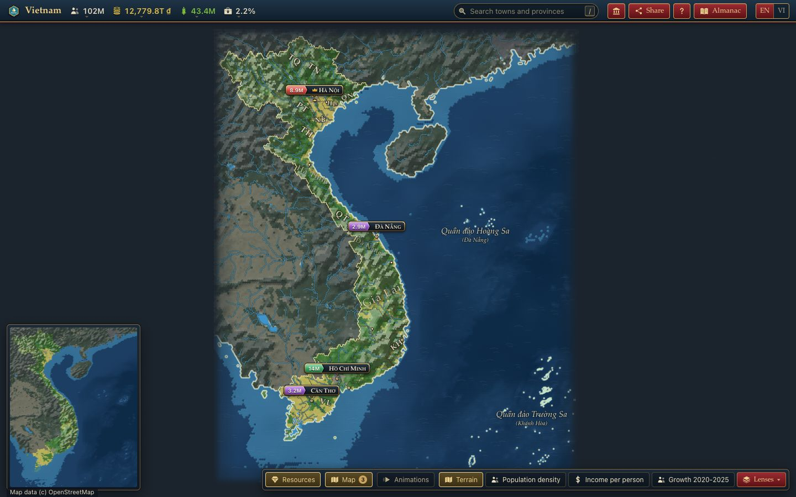

# vnm-civ: Vietnam, the Civ way

**Live map:** [English](https://softonsofa.com/vnm-civ/) | [Tiếng Việt](https://softonsofa.com/vnm-civ/vi/)



A visualizer (not a game) that draws the **real** Vietnam, the Civ way. Hex terrain comes from elevation and land-cover data. City banners carry the 2025 population. Power plants, roads, railways, airports and typhoon tracks sit on the tiles. Every number traces back to a public source in the in-app **Almanac**. The page is in English and Vietnamese (`/vi/`).

## What is on the map

- **The map.** About 5,000 land hexes of 5 km: the Red River and Mekong deltas, the Truong Son range, the Central Highlands and the long coast, with the Hoang Sa and Truong Sa archipelagos in the East Sea.
- **Provinces and towns.** The 34 provinces and centrally run cities of 2025 (with the 63 former provinces under them) and 133 towns with their urban-area population.
- **Lenses.** 41 lenses in eight groups: people (growth, urban population, fertility, migration, life expectancy), prosperity (GRDP, income, poverty, HDI, unemployment), enterprise (investment, active enterprises, industry, retail, night lights), governance (PCI 2025 and its sub-indices), farm (rice, aquaculture, fishery, forest), life (doctors, clean water, internet), land and climate (tree cover and its loss, farmland, built-up, rainfall, typhoons).
- **Layers.** Roads, railways, ports and airports, and typhoons, plus 223 power plants of 30 MW or more.
- **Animations.** Typhoon tracks year by year since 1981 and night lights from 2014 to 2024.
- **Advisors.** Eight advisors named after offices of the old court (economy, population, enterprise, governance, farm and sea, daily life, land) and the Cartographer, which turns any column into a table and a chart linked to the map.

## Quick start

You need [uv](https://docs.astral.sh/uv/) (Python 3.11+). Nothing else.

```bash
uv run python -m pipeline serve --port 5975        # http://127.0.0.1:5975/ (English) and /vi/ (Vietnamese)
```

The built data (`web/data/`) is included. `web/` is a static site: plain ES modules and Canvas 2D, no framework, no build step.

To rebuild the data from the publishers:

```bash
uv run python -m pipeline all                      # download (cached in data/raw/), process, build, check
uv run python -m unittest discover -s tests
```

The pipeline is standard-library Python. Sources live in `pipeline/sources/`, builders in `pipeline/build/`, and the shape of every data file in `docs/DATA_CONTRACTS.md`. The Vietnamese texts are in `web/i18n/vi.json`; `scripts/i18n-extract.py` lists the strings that still need a translation.

## Data sources

21 public sources, none needing an API key. The Almanac (Sources page) and `web/data/sources.json` give each one's publisher, licence, vintage and files. Main publishers:

| Publisher | Used for |
|---|---|
| General Statistics Office / National Statistics Office (NSO), Statistical Yearbook 2025 | Provinces: population, GRDP, income, health, farming, enterprises |
| VCCI, PCI 2025 | Provincial competitiveness index |
| geoBoundaries, OCHA (COD-AB) | Province outlines |
| OpenStreetMap contributors (Overpass, osmdata) | Coast, roads, railways, ports, power plants, towns |
| European Commission JRC (GHSL), WorldPop | Urban centres, population grid |
| ESA WorldCover, Copernicus Global Land Service, NOAA ETOPO 2022, HydroSHEDS, Natural Earth | Land cover, relief, rivers |
| NOAA IBTrACS, CHIRPS, Global Forest Watch, VIIRS night lights | Typhoons, rainfall, tree cover loss, night lights |
| OurAirports | Airports |

## Reading the map honestly

- **Positions are schematic.** Each hex shows the place it covers.
- **Missing data stays missing.** It is null, never 0.
- **Selections are rules.** Power plants and airports are picked by rules published in the data files and shown in the app.

## Licence and credits

A fork of pol-civ by Jarek Tkaczyk (https://softonsofa.com/pol-civ/), itself a fork of usaciv by Andrej Karpathy (MIT).

The code is MIT-licensed (see [LICENSE](LICENSE)). The licence covers the code only. The data belong to their publishers and are used under their terms, listed per source in the Almanac: OpenStreetMap data (c) OpenStreetMap contributors under the ODbL, so the derived coast, road, rail, airport, port and power-plant data in `web/data/` stay under the ODbL; NSO and PCI figures are reused with the source named; ESA WorldCover, GHSL, WorldPop, Global Forest Watch and the VIIRS series are CC BY 4.0.
